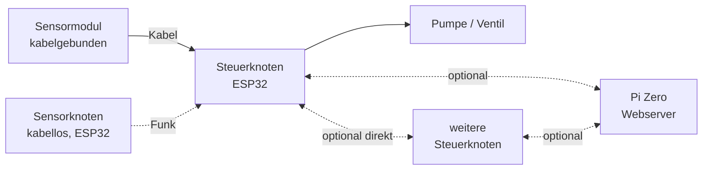

# Automatisiertes modulares Bewässerungssystem

> Modulares, **ESP32-basiertes** Bewässerungssystem: Ein Steuerknoten wertet Sensordaten aus und steuert die Bewässerung (z. B. per Pumpe und Tropfschlauch). Der Gesamtaufbau ist **individuell zusammenstellbar**.

## Überblick

- **Steuerknoten** (ESP32) wertet Sensordaten aus und steuert Pumpe/Ventil
- **Sensoren** sind entweder
  - kabelgebunden direkt am Steuerknoten angeschlossen *oder*
  - kabellos als eigenständige Sensorknoten eingebunden
- **Raspberry Pi** (z. B. Zero, optional) bündelt mehrere Steuerknoten zu einer Gesamtübersicht mit zentraler Konfiguration

## Modularer Aufbau

| Baustein | Hardware | Aufgabe |
|---|---|---|
| **Sensormodul** (kabelgebunden) | Sensor | Wird direkt an den Steuerknoten angeschlossen. Misst z. B. Bodenfeuchte, Temperatur, Licht oder Luftfeuchte. |
| **Sensorknoten** (kabellos) | ESP32 + Sensor(en), Batterie/Akku | Misst in Intervallen, sendet die Werte drahtlos an einen Steuerknoten, schläft dazwischen im **Deep Sleep**. |
| **Steuerknoten** | ESP32 | Empfängt Werte der Sensorknoten, liest angeschlossene Sensormodule aus, entscheidet anhand der Konfiguration, steuert Pumpe/Ventil. Stellt eine eigene **Website** und **REST-API** bereit. |
| **Pi Zero** (optional) | Raspberry Pi | Webserver. Führt mehrere Steuerknoten zu einer Übersicht zusammen, speichert den **Langzeitverlauf** und ermöglicht **zentrale Konfiguration**. |

> [!note] Austauschbarkeit
> Sensoren und Aktoren sind austauschbare Module – Sensoren verschiedener Hersteller sind möglich.

## Ausbaustufen

| Stufe | Aufbau | Funktionen |
|---|---|---|
| **1 – Minimal** | Ein Steuerknoten + ein oder mehrere Sensoren (kabelgebunden, kabellos oder gemischt) | Konfiguration über die Website des Steuerknotens |
| **2 – Mehrere Steuerknoten mit Pi** | Mehrere Steuerknoten + Pi Zero | Gesamtübersicht, zentrale Konfiguration aller Knoten, Verlauf |

Mehrere Steuerknoten können optional auch **ohne Pi direkt miteinander** kommunizieren.

## Weitere Ideen

- [ ] Home-Assistant-Anbindung
