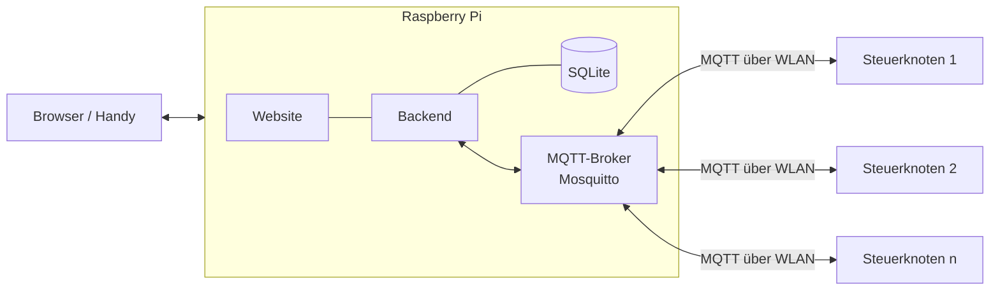

# Zentrale (Raspberry Pi + Website)

> Optionaler Baustein ab **Ausbaustufe 2**: bündelt mehrere Steuerknoten zu einer Gesamtübersicht.

## Aufgaben der Zentrale
- **Übersicht:** Live-Werte aller Steuerknoten und Sensoren auf einer Seite
- **Verlauf:** Messwerte langfristig speichern und als Diagramm zeigen
- **Zentrale Konfiguration:** Knoten, Sensoren, Pumpen und Schwellwerte an einer Stelle einstellen und an die Knoten schicken
- **Übergreifende Regeln/Warnungen:** z. B. „Knoten offline“, „Akku niedrig“, „Flasche leer“

## Was die Zentrale *nicht* macht
- **Die Gießlogik läuft auf dem ESP32-Steuerknoten.** Fällt der Pi aus, wird trotzdem weiter gegossen.
- Die eigene Website des Steuerknotens bleibt bestehen. Die Zentrale ist nur ein Zusatz.

## Überblick

## Dokumente
- [HARDWARE.md](HARDWARE.md): welcher Rechner und welches Zubehör
- [TECHSTACK.md](TECHSTACK.md): welche Software
- [SCHNITTSTELLE.md](SCHNITTSTELLE.md): wie Pi und Steuerknoten über MQTT miteinander reden
- [VORGEHEN.md](VORGEHEN.md): Schritt für Schritt zum Ergebnis
- [BACKLOG.md](BACKLOG.md): alle Aufgaben, aufgeteilt auf uns beide
